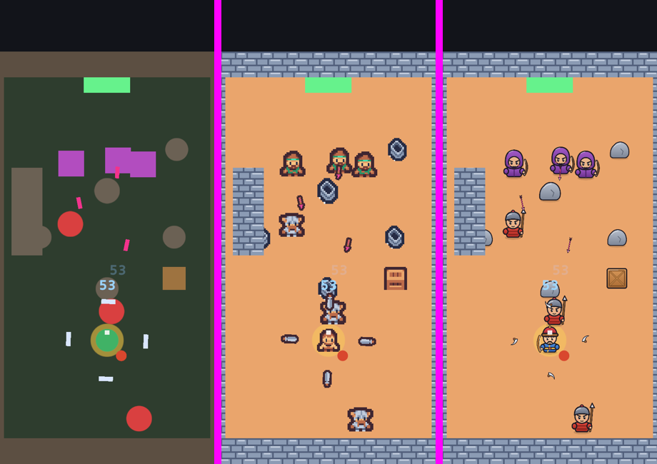
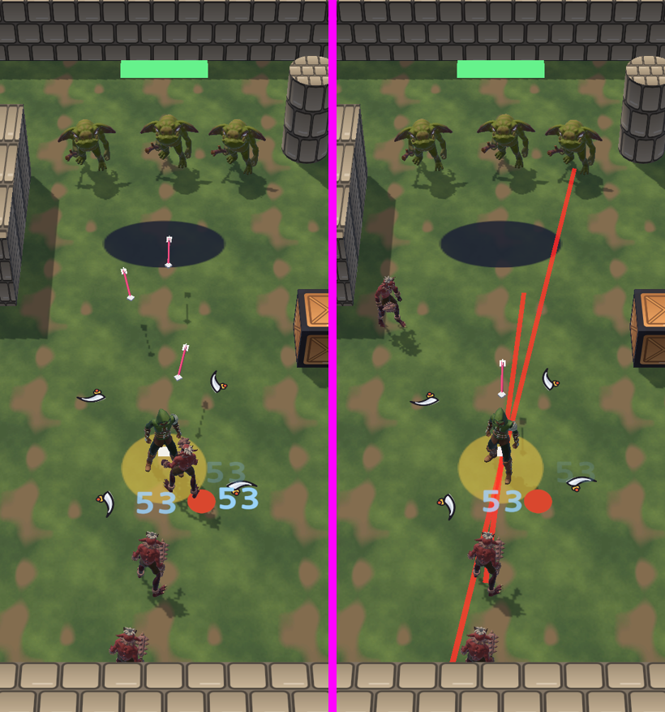
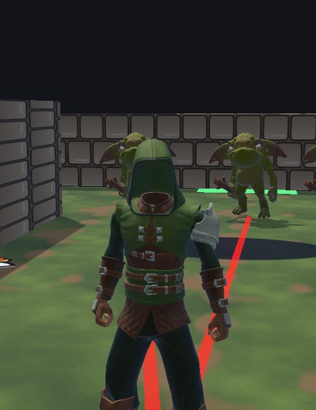

# 그래픽 방향 비교 (2026-10-27)

> [Art 3장 "비교 실험"](../Design/Art.md#3-비교-실험-무료-에셋-vs-ai-직접-제작) · [v1.0 계획 4장](../Dev/v1.0-Plan.md#4-개발자에게-필요한-것-갈래-2) "그래픽 방향"
> 개발자 의견 (2026-10-27): "너무 아기자기한데?", "2d 말고 3d는 안되려나", "3d 모션을 만들 수 없다면 2d 해도 되는데 지금 이건 너무 별로야 앞 뒤가 같은 그런거 아니야?"

## 1. 2D 샘플 (같은 멈춘 순간을 그림만 바꿔 찍음)

왼쪽부터 지금 임시 도형 · **A** 무료 픽셀 에셋 (Kenney Tiny Dungeon, CC0) · **B** AI가 코드로 그린 SD 그림 (SVG).

- 개발자 판단: **둘 다 별로** — 아기자기하고, 그림 한 장이라 **앞·뒤·옆이 똑같고 움직임이 없다**.
- 2D로 방향·동작까지 하려면 캐릭터마다 4~8방향 × 걷기·쏘기·맞기·쓰러짐 그림이 필요하다 (사람이 그리거나 유료 생성 도구).

## 2. 3D 샘플 (게임 규칙은 2D 그대로, 보이는 것만 3D)

- 에셋: Quaternius (모두 **CC0**, 상업 무료) — *Modular Character Outfits - Fantasy* (실제 비율 사람), *Bestiary - Dungeon Monsters* (도깨비 Imp · 고블린 Puglin), *Universal Animation Library 1·2* (휴머노이드 동작 170여 개). 바닥 풀밭은 코드로 만든 노이즈 무늬, 벽·상자는 B 그림.
- 방식: 2D 판정(XY 평면)은 그대로 두고, 영웅·적 위에 3D 모델을 얹어 **움직이는 쪽으로 몸을 돌리고** 서기 ↔ 걷기 ↔ 뛰기 · 쏘기 · 맞음 · 쓰러짐 동작을 한다. 카메라는 40° 눕혀서 내려다본다 (아처로처럼). 그림자 있음.
- 코드: `Dev/ArtPreview3D` (Play 중에만 켜는 미리보기), `Editor/Art3DSample` (가져오기 · 재질 · 동작 컨트롤러 · 프리팹 · 3D 렌더러). 에셋은 `Game/Assets/ThirdParty/Quaternius` (**방향이 정해지기 전이라 git에 올리지 않음**, 67MB).

### 무료 에셋의 한계 (확인함)
| 한계 | 해결 방법 |
|---|---|
| 무료판 옷(Ranger·Peasant)에 **머리가 없다** — 두건 속이 비었다 (아래 사진), 농부는 머리 없는 몸 | ① 무료 기본 몸(Superhero)에서 머리만 떼어 붙인다 (코드로 가능, 무료) ② Source판 $19.99~ (Regular 몸·머리·기사 옷 포함) |
| **활 쏘는 동작이 없다** (주문 쏘기로 대신) | Mixamo (무료, Adobe 계정) "Standing Draw Arrow" 같은 활 동작을 휴머노이드로 옮긴다 |
| 역사 인물 얼굴·옷 (칭기즈 칸 · 관우 · 나폴레옹 · 테슬라)은 없다 | 무료 몸 + 옷 조합 + 색 바꾸기, 또는 3D 생성 도구(유료)·외주 |
| 서바이벌은 적이 250마리 — 3D 캐릭터(약 1.3만 삼각형)를 그대로 쓰면 폰에 무겁다 | 잡몹은 가벼운 모델 + 동작을 텍스처로 구운 인스턴싱, 화면 안 적 수 제한 (아처로류는 보통 수십 마리) |

## 3. 정할 것 (개발자)
- **3D로 간다** (추천): 방향·동작 문제가 저절로 풀리고 아기자기하지 않다. 무료 에셋 + 머리 붙이기 + Mixamo 활 동작으로 시작, 부족하면 유료 Source판.
- **2D로 간다**: 덜 아기자기한 그림체로 다시 (방향별 그림이 필요 — 유료 생성 도구나 사람 손).

**결정 (개발자, 2026-10-27): 3D, 무료로 시작.** → [3D 전환 계획](../Dev/Art3D-Plan.md). Art.md · GameDesign.md를 같이 고쳤다.
