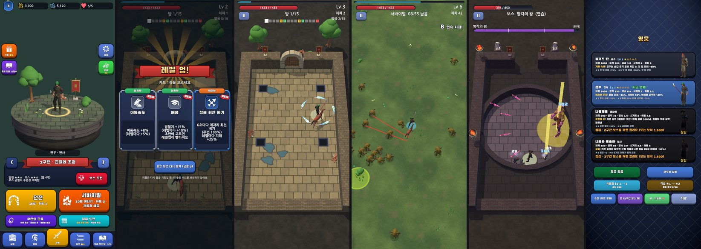

# 그래픽 재평가 (Codex, 2026-10-27 밤)

- 앞 평가: [그래픽 평가](2026-10-27-graphics-eval.md) (전투 4 · UI 2.5)
- 그 사이 한 것: 화면 후처리와 구간 색 · UI 부품과 레벨업 카드 · 블렌더 소품으로 맵 꾸미기 · 스킬 3D 모델과 꼬리 빛 · 맞음 불꽃 · 뽕맛 연출 · 아처로식 로비 · 모델 다듬기
- 평가: Codex `gpt-6-sol` (read-only, effort high), 캡처 6장

왼쪽부터 로비 · 레벨업 카드 · 던전 전투 · 서바이벌 · 5구간 보스 · 영웅 화면.

## 점수

| | 앞 | 지금 |
|---|---|---|
| 전투 화면 | 4 | **6** |
| UI · 로비 | 2.5 | **5.5** |

## 결정 (Claude)

| 순서 | 할 일 | 결정 |
|---|---|---|
| 바로 | 가장자리 어둡게(비네트)가 벽 옆 적·탄을 가린다 | 0.2 → 0.12 |
| 바로 | 물웅덩이가 구덩이(위험)처럼 보인다 | 던전 바닥 장식에서 물웅덩이를 뺀다 |
| 바로 | 로비 섬이 작고 위가 비었다 | 섬을 키우고 조금 올린다 |
| 1 | 캐릭터가 먼저 보이게 | 영웅 고유색을 밝게, 뒤에서 비추는 테두리 빛, 발밑 표시를 예고와 다른 모양으로 |
| 2 | 전투 HUD 정리 | 다음 묶음 |
| 3 | 영웅·보조 화면 새로 | 다음 묶음 |
| 4 | 바닥 반복·방 밖 빈 곳 | 바닥 무늬 변형 + 방 밖 지형 |
| 5 | 평평한 스킬 효과 입체화 | 진행 중 (장판 입자 · 유성 낙하 · 방패 · 낙뢰 터짐) |
| 6 | 적 실루엣 구분 | 블렌더 소품 (머리·무기) 다음 묶음 |
| 8 | 보스 예고 우선순위 | 장식 불빛을 어둡게, 예고는 외곽선·깜빡임 박자를 통일 |

## 원문

## 점수

| 분야 | 이전 → 현재 | 판단 |
|---|---:|---|
| 전투 장면 | **4 → 6/10** | 조명, 장식, 문과 스킬 궤적 덕분에 방과 공격의 형태가 잡혔다. 다만 작은 캐릭터와 반복 바닥이 화면의 완성도를 제한한다. |
| UI·로비 | **2.5 → 5.5/10** | 로비 디오라마와 공통 UI 장식으로 첫인상이 크게 좋아졌다. 영웅 화면과 전투 HUD까지 보면 아직 한 게임의 완성된 화면처럼 이어지지는 않는다. |

정지 화면 기준 평가다. 애니메이션의 손맛과 실제 기기에서의 가독성은 점수에 반영하지 않았다.

## 아직 싼티 나는 곳

- **로비:** 떠 있는 섬은 방향이 좋다. 다만 영웅과 섬이 화면 중간의 작은 덩어리로 보이고, 위쪽은 크게 비어 있다. 아래쪽은 챕터 설명·모드·도전·탭이 한꺼번에 빽빽하다.
- **레벨업 카드:** 리본과 카드 테두리는 좋아졌지만 세 카드의 본문이 작고 촘촘하다. 금빛 광선은 선택의 순간을 강조하면서도 화면 뒤 전투 상황을 지저분하게 만든다.
- **던전 전투:** 바닥 줄눈이 거의 같은 간격으로 끝까지 반복된다. 방 밖의 어두운 빈 공간은 성의 일부보다 무대 바깥처럼 보인다. 영웅의 검은 옷은 바닥에 묻힌다.
- **서바이벌:** 풀과 꽃이 들어왔지만 넓은 화면은 여전히 단조롭다. 적 여러 마리가 같은 갈색 형태로 보이고, 작은 영웅·붉은 조준선·푸른 발밑 효과가 겹친다.
- **보스:** 경기장 구도와 횃불은 확실히 좋아졌다. 하지만 보스와 영웅이 작고 어두우며, 노란 공격 예고와 바닥 조명, 분홍 탄환이 한 지점에 몰려 공격 범위를 읽기 어렵다.
- **영웅:** 가장 뒤처진 화면이다. 작은 모델과 긴 수치 문장이 카드 네 장에 반복되어 캐릭터 선택 화면보다 데이터 목록처럼 보인다.

## 다음 8가지

| 순위 | 개선 | 구체적인 작업 | 노력 | 폰 비용 |
|---:|---|---|:---:|:---:|
| 1 | **캐릭터를 먼저 보이게** | 영웅 의상·무기·머리에 밝은 고유색을 반복하고, URP 머티리얼의 명암을 단순화한다. 발밑 표시를 공격 예고와 다른 형태로 만들고 실제 화면 크기에서 실루엣을 확인한다. | M | 낮음 |
| 2 | **전투 HUD 정리** | HP·XP의 색과 두께를 분리하고 숫자는 필요한 곳만 남긴다. 방 진행 작은 사각형에는 현재 방·보상·보스를 형태와 색으로 구분한다. 상단 UI를 안전 영역에 맞춰 다시 배치한다. | M | 낮음 |
| 3 | **영웅과 보조 화면 재설계** | 영웅 한 명을 크게 보여주고 이름·역할·고유 능력을 먼저 읽게 한다. 성장 수치는 접거나 별도 영역으로 보낸다. 장비·기록 화면도 같은 정보 순서를 쓴다. | L | 낮음 |
| 4 | **바닥과 방 밖 공간 정리** | 바닥 타일에 3~4종의 명도·마모 변형을 섞고 큰 형태의 얼룩을 드물게 얹는다. 방 밖에는 낮은 밝기의 지형·안개·잔해를 깔아 검은 공백을 없애되 전투 바닥보다 눈에 띄지 않게 한다. | M | 낮음~중간 |
| 5 | **평면 스킬 효과 입체화** | 불꽃 지대·독구름·번개·화살비·운석·방패에 높이와 시간 변화를 준다. 얇은 바닥 범위 표시 위에 소수의 메시·파티클·왜곡을 얹고 발광 면적과 지속 시간을 제한한다. | L | 중간~높음 |
| 6 | **적 종류를 실루엣으로 구분** | 색만 바꾸지 말고 머리·무기·어깨 폭·달리는 자세를 유형별로 갈라준다. 서바이벌 화면에서 540px 폭으로 축소해도 위협 종류가 보이는지 확인한다. | M | 낮음~중간 |
| 7 | **로비 디오라마의 자리 키우기** | 섬과 영웅을 조금 확대하거나 위로 올려 상단 공백을 줄인다. 챕터 카드와 두 주요 모드 버튼은 유지하되 작은 도전 버튼·설명 문구의 밀도를 낮춘다. | M | 낮음 |
| 8 | **보스 예고와 피격 효과의 우선순위 통일** | 위험 범위는 일정한 외곽선·채도·점멸 박자를 쓰고 장식 조명은 더 어둡게 한다. 아군 궤적, 적 탄환, 위험 예고의 색과 두께를 서로 구분한다. | M | 낮음~중간 |

## 읽기 어려워진 곳

현재 캡처에서 **Bloom 자체가 가장 큰 문제로 보이지는 않는다.** 보스 화면의 노란 범위와 횃불처럼 밝은 요소가 겹치는 장면이 더 문제다. 비네트는 던전·보스의 좌우 가장자리를 지나치게 어둡게 만들어 벽 옆 적과 탄환을 놓치게 할 수 있다. 벽 근처 장식과 바닥의 검은 구멍·물웅덩이는 실제 위험 요소인지 헷갈린다. 회전 칼날의 푸른 궤적은 잘 보이지만 영웅 주변을 가로지를 때 적 탄환보다 먼저 시선을 끈다. 전투 중에는 **적의 공격 예고와 영웅 위치가 장식·아군 효과보다 먼저 읽혀야 한다.**