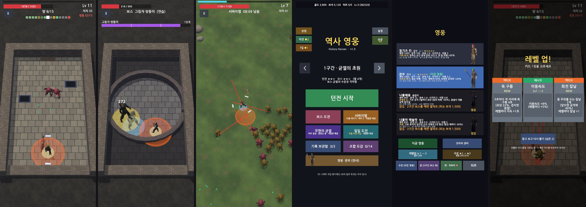

# 그래픽 평가 (Codex, 2026-10-27)

- 계기: 개발자 의견 (2026-10-27): "그래픽 작업이 조금 아쉬운데 코덱스한테 평가 맡겨봐"
- 평가: Codex `gpt-6-sol` (read-only, effort high). 에디터 캡처 9장: 던전 2 · 확대 1 · 보스 · 서바이벌 · 로비 · 영웅 화면 · 레벨업 카드 · 보상 방. 기준은 같은 장르 출시작 (Archero 2 · Survivor.io · Capybara Go)
- 앞선 점검: [3D 화면 점검 1차](2026-10-27-art3d-visual-qa.md) · [2차](2026-10-27-art3d-visual-qa-2.md) (작은 캐릭터, 예고 가림 같은 읽기 문제는 거기서 고쳤다. 이번에는 "완성도·통일감"을 본다)

왼쪽부터 던전 전투 · 보스 (그림자 쌍둥이) · 서바이벌 · 로비 · 영웅 화면 · 레벨업 카드.

## 점수

| | 점수 (10점 만점, 출시 화면 기준) |
|---|---|
| 전투 화면 | **4** |
| UI · 로비 | **2.5** |

**가장 큰 이유:** 바닥, 캐릭터, 효과, UI가 서로 다른 그림체와 명암 규칙을 쓴다. 모델의 폴리곤 수보다 화면 전체의 통일감과 첫인상에서 차이가 크다.

## 확인한 사실 (Claude)

- 화면 후처리가 **하나도 없다.** 장면에 Volume이 없고, URP 색 보정 모드는 기본(LDR)이다. 그래서 빛 번짐, 색 보정, 톤 매핑이 모두 꺼져 있다. 3번 작업은 작은 일로 큰 차이를 낼 수 있다.
- 회전 칼날은 흰 납작한 상자다 (`SceneBuilder.Fx3D`에 칼날 모양이 없다). 문은 초록 사각형, 보상 방은 검은 배경에 색 블록 3개다.
- 10번 (폰에서 확인)은 이미 남아 있는 폰 성능 시험과 같이 한다.

## 계획 (제안, 스타일 방향은 개발자가 정한다)

Codex가 추천한 스타일은 "밝고 선명한 판타지 보드게임풍 3D"다. 하지만 개발자는 2D 샘플을 보고 "너무 아기자기하다"고 했다. 그래서 **사람 비율은 그대로 두고 재질과 색만 맞추는 쪽**("선명한 판타지", 귀엽게 바꾸지 않음)을 기본안으로 둔다.

| 순서 | 묶음 | Codex 항목 | 노력 |
|---|---|---|---|
| 1 | 빛·색 다시 잡기: 후처리 (톤 매핑, 약한 빛 번짐, 색 보정), 바닥 한 단계 밝게, 장(章)마다 색 | 3 | 작음 |
| 2 | 효과 공통 규칙: 아군은 청록·금, 적은 주황·빨강. 트레일, 맞을 때 파편, 짧은 번쩍임. 칼날 모양 만들기. 예고 선 정리 | 6 · 7 | 중간 |
| 3 | UI 스킨 하나로: 테두리 9칸 자르기, 4~5색, 아이콘, 글자 크기 규칙. 로비 첫 화면 (큰 영웅, 배경), 카드, 보상 방 | 1 · 2 · 9 | 큼 |
| 4 | 바닥·소품: 반복 줄이기, 깨진 타일, 벽가 장식 (깃발 · 횃불 · 석상), 상자 2~3종 | 4 · 8 | 중간 |
| 5 | 캐릭터 재질 통일: 같은 셰이더 (단계 명암 + 약한 테두리 빛), 영웅 대표색 | 5 | 중간 |

## 원문

### 총평

**스토어 출시 화면 기준: 전투 4/10, UI·로비 2.5/10.** 3D 전환으로 공간감은 생겼고, 보스 원형 경기장처럼 구도가 잡힌 장면도 있습니다. 하지만 현재는 플레이 화면 위에 임시 UI를 얹은 개발 빌드처럼 보입니다. **가장 큰 이유는 바닥·캐릭터·이펙트·UI가 서로 다른 그림체와 명암 규칙을 쓰기 때문**입니다. Archero 2, Survivor.io, Capybara Go!의 스토어 화면과 나란히 두면, 이 게임은 모델의 폴리곤 수보다 화면 전체의 통일감과 첫인상에서 차이가 큽니다.

### 분야별 진단

- **조명·색:** 던전은 회갈색 바닥과 벽이 화면 대부분을 차지해 평평하고 어둡습니다. 캐릭터의 어두운 옷도 바닥에 묻힙니다. 보스전은 더 어두워 위협적인 분위기보다 정보가 사라진 느낌입니다. 현재 Stage 빌더(`SceneBuilder.Stage.cs`)는 강한 방향광, 평면 주변광, 반복 텍스처 중심이라 장면별 색 연출이 약합니다.
- **환경:** 같은 돌무늬가 넓게 반복되고, 나무 상자는 배치만 다른 동일한 직육면체로 보입니다. 넓은 검은 방 바깥 공간도 완성된 세계보다 촬영 세트처럼 느껴집니다. 초원 생존 모드는 풀색을 제외하면 지형의 개성이 거의 없습니다.
- **캐릭터:** 관우의 녹색 머리와 청룡도는 단서가 되지만 전투 크기에서는 얼굴·의상보다 무기와 발밑 표시가 먼저 읽힙니다. 사실 비율 인간과 둥글고 과장된 몬스터의 형태·질감이 다르고, 적 무리에서는 개체별 역할이 색으로 충분히 분리되지 않습니다. 이는 이전 리뷰의 단순 크기 조정 문제와 별개입니다.
- **VFX:** 주황 위험 원, 가는 빨간 조준선, 작은 보석, 흰 막대 같은 칼날이 각각 다른 게임의 표시처럼 보입니다. 공격이 맞는 순간의 빛·파편·짧은 잔상이 약해, 숫자 `272`가 떠도 타격의 무게가 적습니다. 생존 모드에서는 여러 빨간 선이 영웅에게 모여 핵심 위험을 읽기 어렵습니다.
- **UI:** 로비의 넓은 빈 배경, 무지개색 직사각형 버튼, 작은 영웅 초상, 개발 중 안내 문구가 첫인상을 크게 낮춥니다. 영웅 화면은 글이 빽빽하고 모델이 작습니다. 레벨업 카드는 긴 설명이 중앙에 몰려 있고, 보상 화면은 검은 배경에 색상 블록 세 개뿐입니다. HUD의 작은 칸과 숫자도 정보의 중요도가 드러나지 않습니다.

### 우선순위 작업 목록

| 순서 | 할 일 | 구체적 방법 | 노력 | 폰 부담 | 누가 |
|---|---|---|---|---|---|
| 1 | **로비 첫 화면 재구성** | 큰 영웅 전신 또는 상반신을 중앙에 두고, 챕터 배경 그림·주요 시작 버튼·보조 메뉴 순으로 배치. 출시 화면에서 개발 안내 문구 제거 | M | 낮음 | AI 에이전트 + Blender·무료 리소스. 완성도 높은 삽화는 사람/생성 이미지 선택 사항 |
| 2 | **UI 스킨 하나로 통일** | 9-slice 테두리, 제한된 4~5색, 아이콘 세트, 제목·본문 글자 크기 규칙 제작. 로비·영웅·보상·레벨업 카드에 공통 적용 | M | 낮음 | AI 에이전트 + 무료/CC0 아이콘 |
| 3 | **전투 색과 명암 재설정** | URP Volume에서 Tonemapping ACES, 약한 Color Adjustments·Bloom을 장면별로 시험. 바닥은 한 단계 밝게, 캐릭터의 주요 색은 더 선명하게. Bloom은 발광체에만 제한 | S | 낮음~중간 | AI 에이전트 |
| 4 | **바닥 패턴의 존재감 줄이기** | 돌 줄눈 대비와 반복 규칙을 낮추고, 큰 색 변화·깨진 타일·가장자리 장식을 드물게 배치. 초원도 풀색 덩어리와 흙길을 섞되 위험 표시 아래는 단순하게 유지 | M | 낮음 | AI 에이전트 + Blender/무료 텍스처 |
| 5 | **캐릭터 재질 통일** | 영웅·몬스터에 같은 URP Shader Graph의 단순한 명암 단계와 약한 색 테두리를 적용. 금속·천·피부의 광택 범위를 좁히고 영웅별 대표색을 무기까지 반복 | M | 낮음~중간 | AI 에이전트 |
| 6 | **스킬과 피격의 공통 언어 만들기** | 아군은 청록·금, 적 위험은 주황·적색 등으로 고정. 발사→이동→충돌에 짧은 트레일, 4~8개 파편, 0.1초 발광을 묶어 프리팹화. 화면을 가리는 입자는 피함 | M | 중간 | AI 에이전트 |
| 7 | **위험 표시 정리** | 조준선은 발사 직전만 진하게, 여러 적의 선은 투명도·길이 제한. 원형 장판은 진한 내부색보다 선명한 외곽선과 진행 방향 표시를 우선 | S | 낮음 | AI 에이전트 |
| 8 | **방마다 기억할 만한 장식 추가** | 챕터 1에 깃발·부서진 석상·횃불·문양 등 3~4종을 벽가에 배치. 상자는 형태·뚜껑·띠를 2~3종으로 변형. 충돌 공간에는 장식 최소화 | M | 낮음~중간 | AI 에이전트 + Blender |
| 9 | **카드 정보 다시 편집** | 카드마다 스킬 아이콘, 이름, 한 줄 효과, 수치 순서로 정리. 등급은 카드 전체의 원색 대신 테두리·상단 표식에 사용. 보상 화면에도 아이콘과 선택 반응 추가 | M | 낮음 | AI 에이전트 |
| 10 | **기기별 화면 검증** | 저사양은 그림자·후처리 최소화, 중간은 핵심 발광만, 고품질은 그림자와 MSAA. 실기기에서 전투 중 30fps와 작은 글자·위험 표시 가독성 확인 | S | 낮음~중간 | AI 에이전트 + 개발자 실기기 확인 |

### 스타일 방향

현재 혼합은 **아직 한 게임의 미술로 묶이지 않습니다.** 추천 목표는 **“밝고 선명한 판타지 보드게임풍 3D”**입니다. 사실 비율 인물은 유지하되 피부·천·돌을 모두 약간 단순화한 무광 재질로 맞추고, 몬스터도 같은 명암 단계로 처리하세요. 환경은 채도를 낮춘 무대, 영웅·적·공격은 선명한 주역으로 두면 가독성도 좋아집니다. 사진 같은 돌 질감과 과한 사실적 조명으로 가면 현재 무료 모델의 차이가 더 두드러집니다. 고급 실시간 그림자나 SSAO에 기대지 않아도 구현 가능한 방향입니다.

### 싼티 나는 부분

한눈에 가장 걸리는 것은 **로비의 빈 검은 공간과 색칠한 사각형 버튼**, 보상 화면의 무장식 선택 블록, 레벨업 카드의 빽빽한 글, 전투의 반복 타일과 똑같은 상자, 칼날처럼 보이지 않는 흰 조각입니다. 이 부분을 먼저 고치면 새 캐릭터 모델을 구매하지 않아도 화면의 완성도가 훨씬 크게 오를 것입니다.
