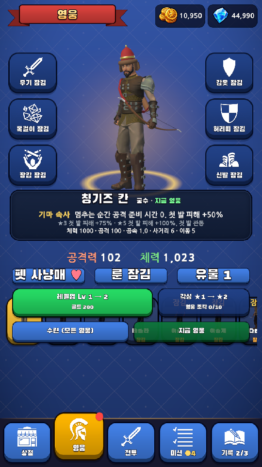
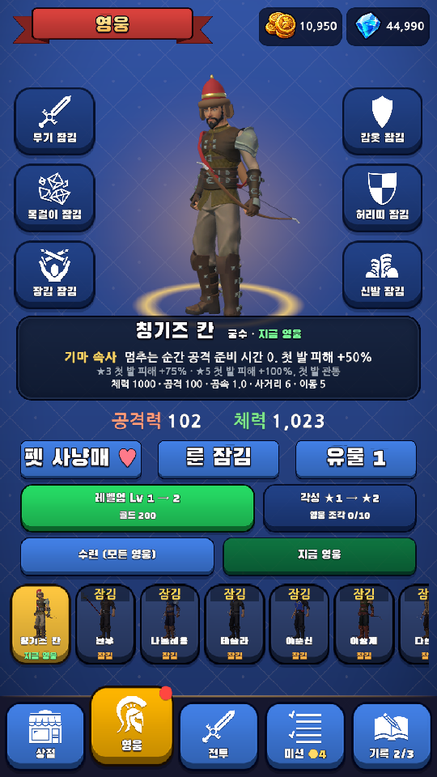

# 모바일 품질 전체 점검 — 1차

2026-11-04 · 범위: 기존 기획·로비/영웅 UI·공통 모션·테스트 실행·저장/광고/결제 경계의 정적 점검.
모든 소스·모든 계정·모든 Android 기기를 검증한 출시 승인은 아니다.

## 확인된 문제

| 우선순위 | 근거 | 재현·영향 | 대응 |
|---|---|---|---|
| 높음 / 출시 미구현 | `RewardedAd.cs:19,24,55` | 릴리스도 기본 FakeRewardedAd.Success. 실제 광고 완료 없이 보상 성공 | 실제 SDK·광고 없음/취소/완료 검증을 출시 조건으로 유지 |
| 높음 / 경제 설계 | `Economy/Wallet.cs:65`, `Records/SaveStore.cs:342`, `Account/AccountService.cs:652,676` | 로컬 보석 잔액·소비를 신뢰. 구매 검증과 별개로 변조·이전 저장 복원이 경제 경계 | 서버 권한·소비/회수 설계를 별도 검토. 정상 저장을 무조건 삭제하는 대응 금지 |
| 중간 / 도구 결함 | `Tools/dev/test.sh` | 실패 테스트도 출력 후 exit 0 | 이번 묶음에서 수정·회귀검사 |
| 중간 / 실제 화면 | `SceneBuilder.TopBar.cs:85`, `SceneBuilder.Lobby.cs:268,505` | 1080×1920: 성장 버튼과 영웅 목록 겹침 | 영웅 화면 내부 배치를 별도 스크롤 영역으로 묶고 짧은 화면에서 접근 보장 |
| 중간 / 실제 모션 | `UI/ButtonJuice.cs` | 선택 탭의 비균등 강조 크기를 누름 복원이 지움 | 외부에서 바꾼 기준 크기 보존 |
| 중간 / 검증 공백 | `Tools/gate.sh:27`, `.github/workflows/pages.yml` | 머지 검사에서 서버 결제 테스트 누락 | 서버 변경 시 필수 테스트/CI 연결을 후속 작업으로 추적 |
| 낮음 / 산술 경계 | `Economy/Wallet.cs:16-30` | int 상한 부근 재화 가산 오버플로 | 환불 부채 정책과 함께 별도 경계 검사 후 수정 |
| 측정 필요 | `UI/HeroPortraits.cs:126-154` | 초당 15회 초상 렌더 때 전체 Light 탐색. 실제 병목은 아직 측정 안 함 | Android CPU/GPU·발열 측정 후 조정 |

## 후속 화면 개선 순서

1. 겹침·터치·잘림 → 글자 위계·정보 밀도 → 기록 대표 스킬 그림.
2. 보스/기믹 위험과 적 탄 대비 → 아군 효과 강도 → 구간별 색·조명.
3. 이동/공격 연결과 타격 시점 → 카메라·피격·결과 연출의 강약.
4. 처음 10분과 반복 플레이를 실제 폰에서 확인하고 화면별로 커밋한다.

## 이번 수정과 검증 결과

- 테스트 실행기: 정상·실패·미완료·0개·명령 실패를 구별한다. 자체 회귀검사 **4/4 통과**, 커밋 `ff5d4b9`.
- 영웅 화면: 성장 행동과 목록을 `GrowthViewport`에 묶었다. 펫·룬·유물과 수련·선택의 터치 영역도 키웠다.
- 중첩 입력: `HeroRosterScroll`이 목록 위의 세로 드래그를 부모로 전달한다. 가로는 영웅 목록이 처리한다.
- 누름 모션: 탭 강조·다른 연출이 바꾼 기준 크기를 보존한다. 선택 탭 누름 뒤 `(1.05,1.16,1)` 복원 확인.
- Unity EditMode **846/846 통과**. 기존 835개와 새 배치·모션·드래그 검사 11개를 포함한다.
- 서버 .NET 검사 **96/96**, 확률표 검사 **4/4 통과**. 서버 검사는 로컬 실행이며 GitHub 필수 CI에 연결한 것은 아니다.
- Unity 6000.3.27f1: 컴파일 오류 0, 마지막 Play 점검 시 Console 오류 0.
- 1080×1920, 1080×2340 렌더 확인. 안전 영역을 줄여 영웅 페이지 높이 1600에서 목록 위 세로 드래그로 부모 130, 가로 드래그로 자식 -160 이동 확인.
- 독립 코드 리뷰: 중첩 드래그 전달 누락 1건을 발견해 수정했고, 최종 정적 리뷰에서 추가 차단 없음.
- 기존 QA 임시 저장을 사용하고 실제 계정의 클라우드 시작 호출을 억제했다. 전투 진입과 결과 화면도 관찰했다. 결과는 QA 강제 종료로 띄운 것이며 정상 던전 완주의 증거가 아니다.
- 로비 장면은 Editor에서 필요한 오브젝트만 수정해 기존 참조 ID를 보존했다. 장면·프리팹 YAML 직접 편집은 하지 않았다.

## 화면 근거

| 수정 전 | 수정 후 |
|---|---|
|  |  |

[긴 화면](Images/2026-11-04-mobile-quality/hero-tall.png) · [좁은 안전 영역에서 목록까지 스크롤](Images/2026-11-04-mobile-quality/hero-compact.png) · [전투 관찰](Images/2026-11-04-mobile-quality/battle-audit.png) · [QA 강제 종료 결과](Images/2026-11-04-mobile-quality/result-forced-qa.png) · [수치 결과](Images/2026-11-04-mobile-quality/validation.json)

## 남은 범위

- 전체 아트 방향·긴 화면 정보 밀도·본문 위계·기록 스킬 그림·위험 대비·공격/이동 연출은 다음 개선 단계다. 이번 두 결함 수정으로 전체 디자인이 완성됐다고 판정하지 않는다.
- Android 설치·실제 엄지 터치·다중 터치·발열·복귀, 실제 광고·구매·계정 서버는 미검증.
- 기존 재질 6개와 BlackHanSans 수정은 보존하고 커밋에서 제외했다. Editor가 갱신한 NanumGothic 동적 폰트도 이번 UI 변경에 포함하지 않는다.
