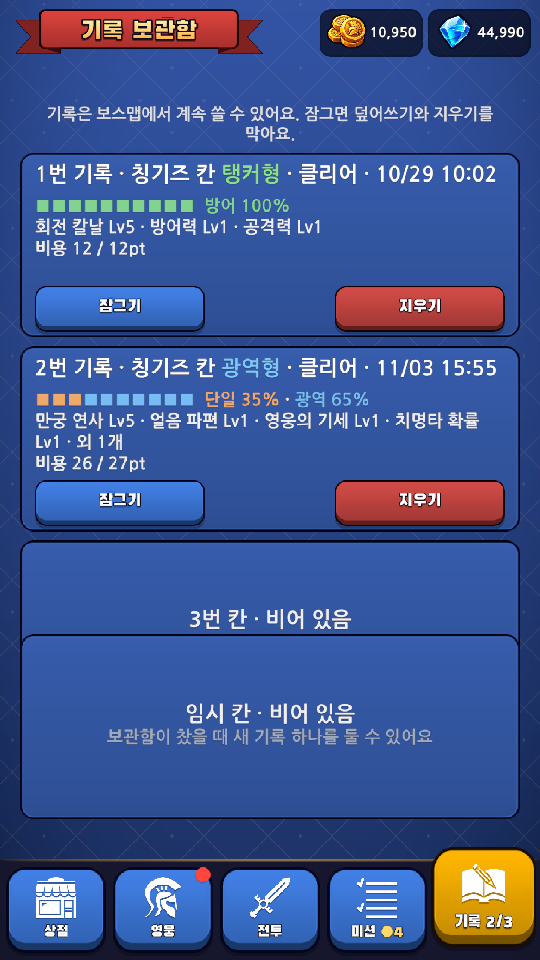
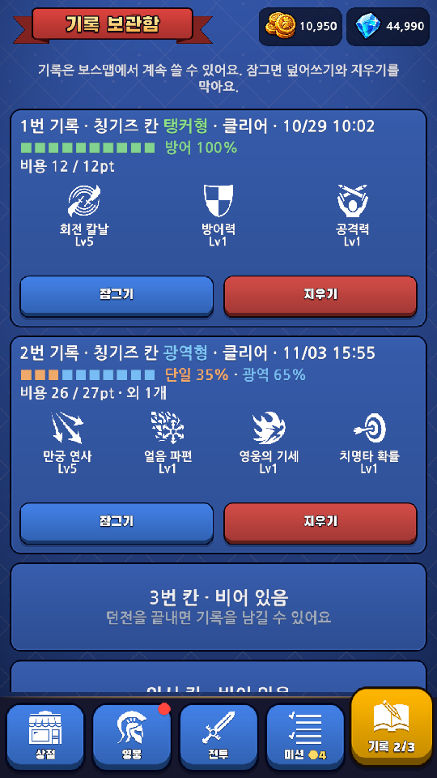

# 모바일 품질 2차 — 기록 비교와 감각 설정

기준: [DESIGN.md](../../DESIGN.md), [실행 계획](../Dev/MobileQuality-Plan.md).

## 변경

- 기록 카드에 검증된 대표 스킬 4개를 기존 그림·이름·레벨로 표시한다. 높은 레벨 순, 같은 레벨이면 기존 순서다.
- 역할 강점·용량·패치 안내·남은 스킬 수는 요약으로 남긴다. 다른 기록 저장/보스 화면의 전체 설명은 유지한다.
- 카드가 내용 높이에 맞게 늘어나고 세 번호 칸과 임시 칸을 세로로 넘길 수 있다. 빈 칸의 스킬·행동 줄은 숨긴다.
- 잠금/삭제의 확인 흐름과 임시 이동 조건은 유지한다. 독립 리뷰에서 임시 칸 표식을 유지하도록 지적해 접두사와 회귀검사를 보완했다.
- 보스 격파의 번쩍임 줄이기 설정 누락도 수정했다 (`9da65b1`). 섬광·신규 흔들림만 생략하며 다른 효과는 유지한다.

## 검증

- 공통·기록·감각 설정 검사 **856개 통과**. 별도 결과 표현 검사 3개를 함께 실행한 전체 Unity EditMode는 **859/859 통과**했다.
- Play에서 저장을 기존 QA 임시 저장으로 전환하고 클라우드 시작 호출을 억제했다. 원래 기기 저장의 기록 2개를 복사해 화면을 확인했다.
- 정상 화면 1080×1920과 긴 화면 1080×2340 확인. 카드 높이는 540.24 / 540.24 / 220 / 220, 사이 간격 20이며 서로 겹치지 않는다.
- 실제 잠금 단추를 눌러 삭제가 숨겨지고 다시 풀리는 흐름을 확인했다. 임시 칸까지 스크롤 가능하고 TMP 넘침은 0이었다.
- 임시 기록·가득 찬 보관함·누락 스킬·패치 안내·빈 칸 잔상은 격리된 EditMode 검사로 확인했다.
- 독립 정적 리뷰의 차단 지적은 해소했다. 컴파일 오류는 없다. 기존 Physics2D NonAlloc 사용의 폐기 예정 경고 9건은 이번 범위에 포함하지 않았다.
- Android 실기기, 실제 클라우드/광고/결제와 사용자 손가락 드래그는 미검증이다. Editor 조작과 구별한다.

## 화면

| 변경 전 | 변경 후 |
|---|---|
|  |  |

[끝까지 내린 화면](Images/2026-11-04-record-quality/archive-bottom.png) · [긴 화면](Images/2026-11-04-record-quality/archive-tall.png) · [수치 기록](Images/2026-11-04-record-quality/validation.json)

## 남은 범위

삭제를 보조 메뉴로 옮기는 정보 구조 변경, 아이콘 색·배경의 전체 아트 방향, 실제 Android 글자 크기/터치 검증은 후속 작업이다. 저장 스키마와 보상·기록 비용은 변경하지 않았다.
