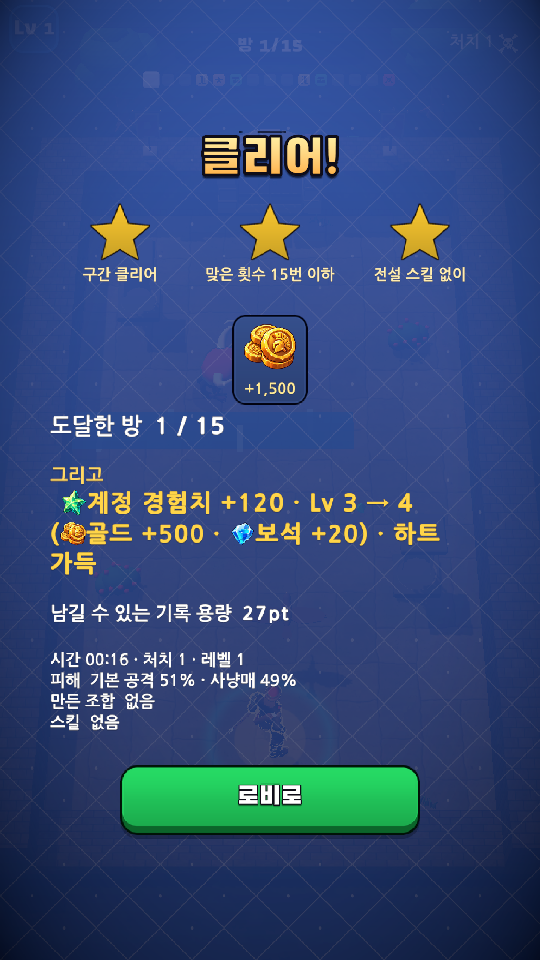
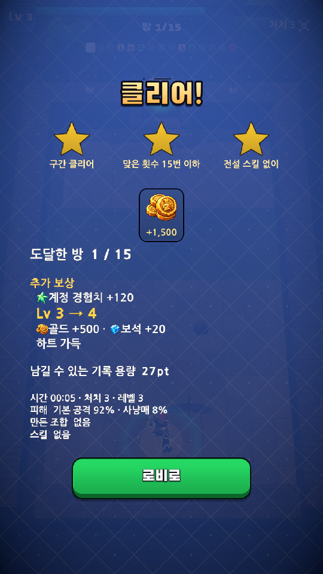

# 모바일 품질 3차 — 결과 보상 위계와 종료 흐름

## 변경 파일과 의도

- `Game/Assets/Scripts/UI/RunResultScreen.cs`: 보상 카드 다음 제목을 "추가 보상"으로 명확히 했다. 공용 `RunText.Level`이 만든 경험치·승급·재화·하트 줄을 결과 화면에서만 나눠 승급만 크게 강조한다. 알 수 없는 형식은 정보 손실 없이 원문으로 남긴다.
- `Game/Assets/Scripts/Survival/SurvivalRun.cs`: 판 종료 때 기존 카드 취소 후 `LevelUpScreen`을 비활성화해 경험치 이벤트 구독과 지연 코루틴을 종료한다. 비동기로 도착하는 마지막 보석이 결과 뒤에 카드 창을 다시 열던 현상을 막는다.
- `Game/Assets/Tests/EditMode/RunResultPresentationTests.cs`: 복수 재화의 중복/누락·원문 불변·레벨업 없음·다른 형식 보존 검사를 추가했다.

보상 계산·지급·저장 스키마·공용 보상 문자열·카드 분리·숫자 증가·기존 건너뛰기 코드는 변경하지 않았다. 종료 수정도 보석 수집과 경험치 계산을 유지한다. 기존 이벤트 해제 동작을 재사용해 새 전역 상태나 별도 종료 관리자를 만들지 않았다.

## 검증

- 최종 Unity EditMode **859/859 통과**, 프로젝트 컴파일 오류 0.
- 격리된 QA 저장으로 던전·보스·서바이벌에 진입한 뒤 강제로 종료해 각 실제 결과 화면을 확인했다. 정상 한 판 완주/클리어 증거로 간주하지 않는다.
- 본문 TMP 넘침은 세 모드 모두 없었고, 1080 기준 본문 크기는 던전 36.95 · 보스 37.65 · 서바이벌 38이었다.
- 던전 결과의 승급·재화·기록 용량, 보스 첫 격파의 여러 카드/장비/별/펫 보상, 보상이 적은 서바이벌 패배를 확인했다.
- 기존 건너뛰기 최종 상태 함수 `ApplyIntro(999)`를 호출해 보상 수치 +1,500과 버튼 활성화를 확인했다. 실제 손가락 입력 및 누른 손을 뗀 뒤의 보호 시간은 이번에 검증하지 않았다.
- 종료 회귀: 종료 전에 레벨업을 예약한 뒤 판을 끝내고, 다시 레벨업 이벤트를 강제로 발생시켜도 UI 비활성/닫힘/대기 0을 확인했다. 잠시 뒤 실제 결과 화면에도 카드 창이 남지 않았다.
- 결과의 실제 [다시 도전] 버튼을 호출해 새 `LevelUpScreen` 인스턴스가 활성화되고, 다음 판의 레벨업이 정상적으로 열리는 것을 확인했다.
- 독립 정적 리뷰에서 보상 표시 및 종료 수명 주기 변경의 차단 결함은 없었다. 마지막 Play Console 오류 0. 기존 Physics2D NonAlloc 폐기 예정 경고는 별도다.

## 화면 근거

| 변경 전 | 변경 후 |
|---|---|
|  |  |

[보스 첫 격파 결과](Images/2026-11-04-result-quality/boss-result.png) · [종료 수정 전 서바이벌](Images/2026-11-04-result-quality/survival-before-end-fix.png) · [종료 수정 후](Images/2026-11-04-result-quality/survival-after.png) · [수치 근거](Images/2026-11-04-result-quality/validation.json)

## 남은 검증

Android 실기기 터치·발열·복귀, 정상 한 판 완주, 실제 계정·광고·결제 서버 호출은 미검증이다. QA는 임시 저장에서 수행했고 원래 기기 진행에 결과를 반영하지 않았다.
