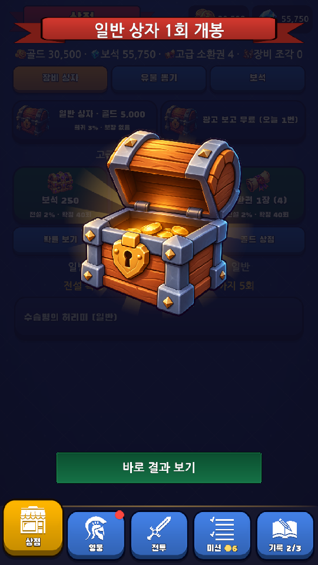
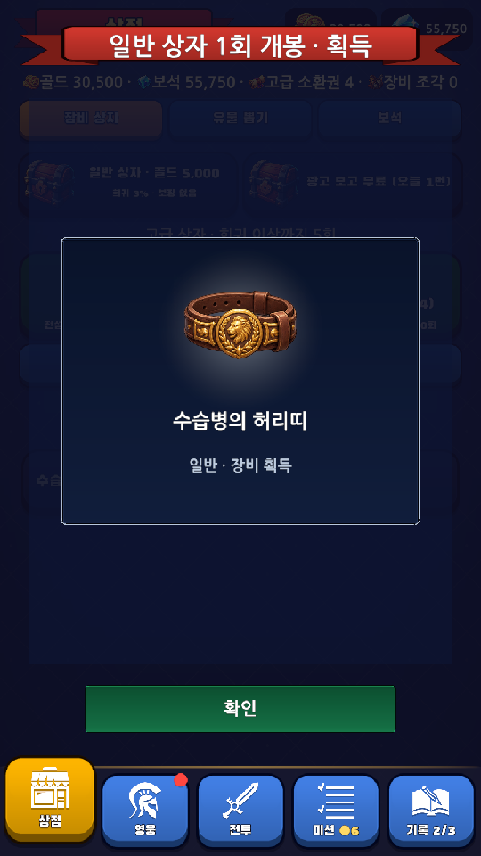
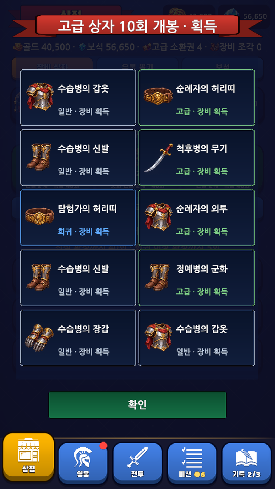
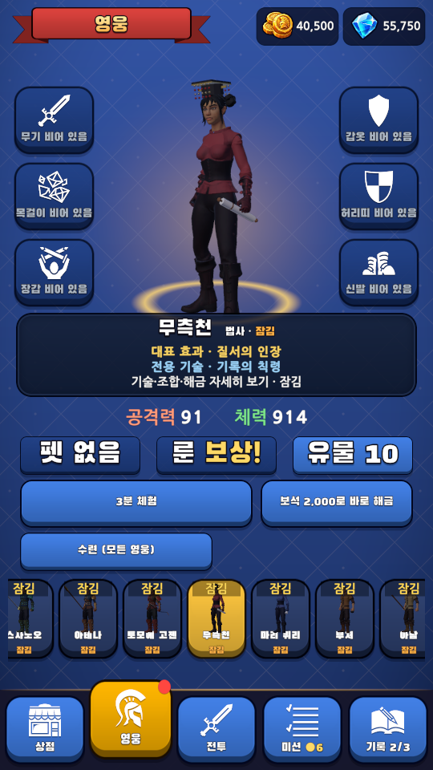
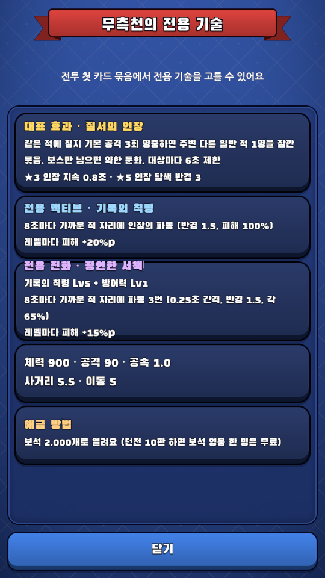
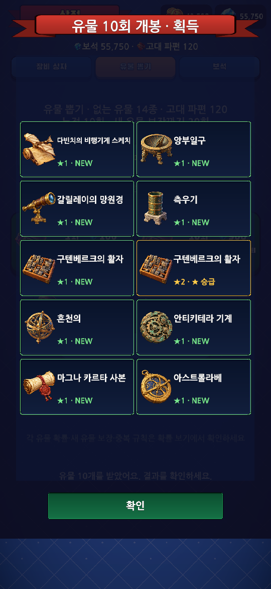
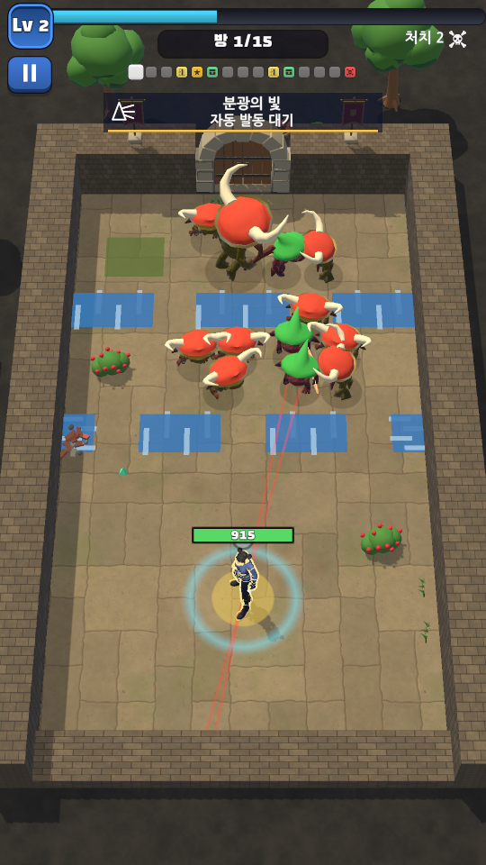
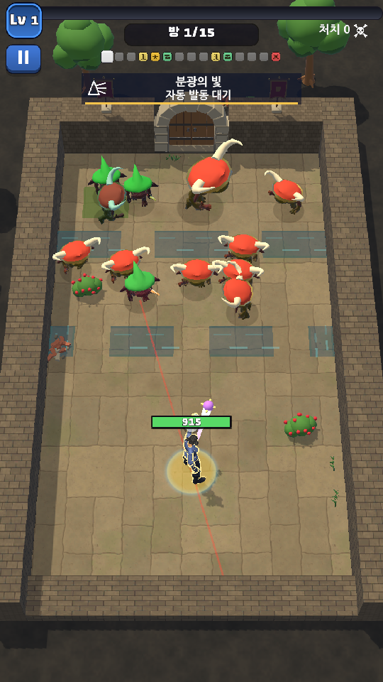
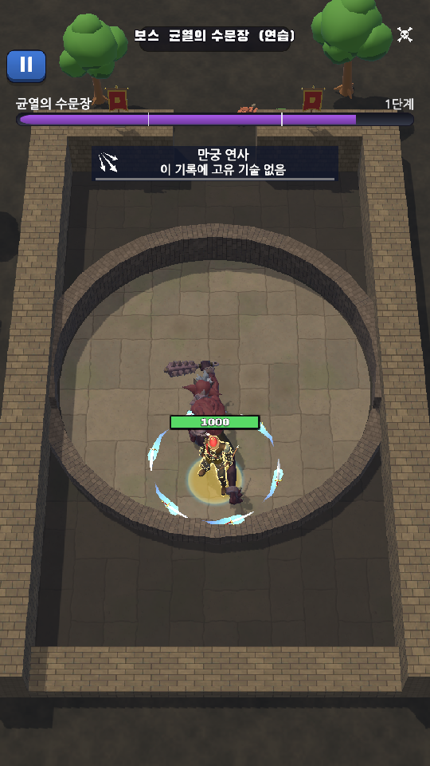

# 보상·영웅 정체성 실제 실행 검증

날짜: 2026-11-05. 브랜치: `feature/reward-hero-identity`.

## 현재 결과

- Unity 6000.3.27f1 실제 컴파일 정상, 전체 EditMode **883/883 통과**. 기존 main의 859개에서 이번 변경의 24개 검사 사례가 추가됐다.
- 실제 Play에서 상자 개봉·장비 1/10회·유물 10회·건너뛰기·화면 비활성화/재진입·중복 입력·저장 실패 경계를 확인했다.
- 영웅 21명 요약은 30pt에서 텍스트 넘침 0. 전용 액티브/진화/합체와 무료 해금 경로를 큰 설명 행에서 확인한다.
- 퀴리의 실제 첫 카드에 `curie_prism`이 포함되고, 선택·발동 피해와 8초 쿨다운 표시를 확인했다.
- 보스 체력바와 새 HUD의 범위가 분리됨을 확인했다. 기록에 고유기가 없는 보스 모드의 안내도 정확히 바꿨다.
- 사용자 원본 저장 5개와 기존 재질 6개·폰트 2개·설정은 Play 전후 바이트 동일하다. QA는 별도 저장 사본에서만 수행했다.

## 이번에 고친 부분

| 영역 | 결과 | 주요 파일 |
|---|---|---|
| 뽑기 | 저장 성공 뒤 닫힌 상자 → 실제 열린 상자 → 결과 카드. 1회는 중앙 큰 그림, 10회는 두 열. 실제 이름·등급·보장·중복·승급 표시 | `ShopPanel`, `GachaReveal` |
| 그림 | 일반·고급 열린 상자와 장비 6슬롯 대표 그림 제작. 유물은 기존 실제 유물 그림 재사용 | `Resources/UI/Gacha`, `Docs/Credits.md` |
| 모바일 이미지 메모리 | 열린 상자는 1254px 무압축 대신 최대512px/ETC2 RGBA, 장비 atlas는 1536×1024/ETC2 RGBA로 설정. atlas를1024로줄이면높이683이되어압축불가라원래비율/4배수크기를유지. 실제Sprite6개·압축후Play결과확인 | 새 이미지 3개의 `TextureImporter` 설정 |
| 한글 | 동적 TMP가 기본 폰트 재질을 써 일부 한글이 청록 사각형으로 보이던 문제 수정. 기존 Body 재질과 spriteAsset도 함께 복사 | `GachaReveal.Label`, `GachaRevealTests` |
| 영웅 선택 | 반복 판의 첫 일반 카드에 습득 가능한 전용기 한 장, 공용/전용 띠 구분, 실제 전용 조합 재료 조건 표시 | `SkillManager`, `SkillCardView`, `HeroPanel`, `CodexPanel` |
| 설명 읽기 | 요약은 30pt, 상세는 40pt/본문 34pt를 유지하고 줄 높이를 늘림. 다음 일반 선택 목록에서는 원래 크기로 복원. 잠긴 영웅의 무료/보스/신 시련 해금 방법 유지 | `ButtonList`, `HeroPanel`, `HeroReadabilityTests` |
| 전용기 피드백 | 실제 발동과 쿨다운을 HUD에 표시. 세 법사의 별·인장·분광 문양을 카드/도감/기록/전투에 일치 | `ActiveSkillBehaviour`, `HeroSkillHud`, `HeroSkillArt`, `AttackFx`, `ConstellationBehaviour`, `RecordArchivePanel`, `HudView` |
| 전투 바닥 | 파란 막대의 원인이 개울임을 런타임에서 확인. 개별 렌더러에 물 alpha .52, 가는 평행 물결 .5×.055와 둑 적용. 원본 재질 alpha .88과 충돌은 유지 | `CreekFlow`, `BattleReadabilityTests` |
| 발밑 고리 | 실제 스프라이트 크기 때문에 2.816유닛이 된 고리를 월드 지름 1.6, alpha .24로 보정. 정지 준비 표시 지름 1.3은 유지 | `StopIndicator`, `BattleReadabilityTests` |

새 의존성을 추가하지 않았다. 기존 효과 풀·UI 키트·스크롤·도감 데이터를 재사용했고 옛 전역 포인터 기반 결과 행 애니메이션을 공통 개봉 모달로 대체했다. 저장 형식/ID·피해·타깃·충돌·가격·상점 확률·천장은 바꾸지 않았다. 첫 카드 구성 보장은 의도한 변경이다.

## 실제 경계 검사

| 확인 | 관찰 결과 |
|---|---|
| 일반 구매를 같은 프레임에 두 번 호출 | 5,000골드 한 번 차감, 결과 1개, 확인까지 구매 잠금 |
| 고급 10회 두 번 호출 | 보석 2,250 한 번 차감, 실제 카드 10개 |
| 유물 10회 두 번 호출 | 보석 900 한 번 차감, 실제 카드 10개. NEW와 별 승급 표시 |
| 결과 건너뛰기 | 모든 카드 표시, 10개 결과의 텍스트 넘침 0 |
| 실제 root 비활성화 후 재진입 | 개봉 닫힘·잠금 해제·상점 다시 열림 모두 true |
| 저장 단계에 I/O 실패 주입 | 40,500골드 유지, 결과 연출 없음. 격리 저장에만 주입 |
| 1080×1920 / 1080×2340 | 카드·확인 단추 접근 및 시각 비교. 자동 검사는 페이지 높이 1600/1720/2140도 포함 |
| 실제 첫 전용 카드 | 퀴리 첫 묶음: 수호 방패·관통·분광의 빛(`curie_prism`, owner=`curie`) |
| 실제 전용기 발동 | 격리 전투에서 액티브 피해 발생, HUD의 쿨다운 8초/남은 약 4초 확인 |
| 보스 HUD | 보스 바 활성 중 고유 HUD 위쪽 595 < 보스 바 아래쪽 644, 49유닛 간격 |
| 물·고리 실측 | 물 per-renderer .52 / shared .88, 물결 .5×.055, 고리 1.5999999×1.5999999 / alpha .24 |

## 실제 화면

열린 상자는 Play에서 `ChestOpen.activeSelf=true`, 결과 공개 전 상태를 자연스러운 애니메이션 중 캡처했다. 화면을 대신 그린 목업이 아니다.

| 개봉 중 | 1회 결과 | 장비 10회 |
|---|---|---|
|  |  |  |

| 영웅 요약 | 전용 기술·해금 방법 | 유물 10회/긴 화면 |
|---|---|---|
|  |  |  |

| 전투 개선 전 | 전투 개선 후 | 보스 HUD |
|---|---|---|
|  |  |  |

## 검증 방식과 한계

- [전체 검사 결과](Images/2026-11-05-game-feel/editmode-results.json), [Play 검사 로그](Images/2026-11-05-game-feel/play-checks.json), [원본 보존 확인](Images/2026-11-05-game-feel/preservation-before-build.json).
- 새 검사 코드는 EditMode의 자동 생명주기 호출을 잘못 가정한 부분과 Editor 전용 어셈블리의 MonoBehaviour 부착 문제를 고쳤다. 실제 비활성화는 Play에서도 따로 확인했다. 재질 불변 검사는 색 공간 왕복 후의 사전 readback과 비교한다.
- 계정과 결제 연결은 보류한 상태에서 원본 저장 사본을 사용했다. 테스트용 보석/골드·해금 설정과 무적/적 생성은 그 사본/Play에만 적용됐다. 실제 결제·광고·서버 저장을 검증하지 않았다.
- `QaTools`와 실제 UI 이벤트 콜백으로 확인한 Editor 검증이다. Android 엄지 터치·노치·복귀·프레임·발열·장시간 플레이와 정상 난이도의 완주는 별도다.
- 기본 활·마법 클립의 동작 폭, 구간별 바닥 아트 변화, 장기 밸런스는 전면 재설계하지 않았다. 이번 결과를 전체 게임의 상업적 성공이나 재미 보장으로 해석하지 않는다.
- 기존 사용자의 재질/폰트·Unity AI 패키지 설정 변경은 기능 커밋과 별도로 보존한다.

## 전달 상태

실행 검증을 통과한 소스를 기능 브랜치에 커밋하고 기존 출시 서명으로 로컬 설치용 APK를 생성한다. APK 서명·패키지/버전·16KB 정렬 검증 결과는 빌드 폴더의 별도 보고서로 남긴다. GitHub release 게시나 Play Console 배포는 이번 범위에 포함하지 않는다.
