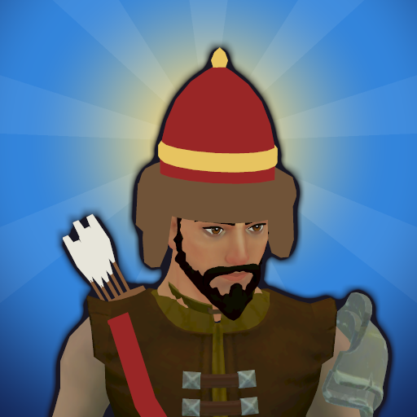

<div align="center">



# 🏹 History Heroes

### 역사영웅 로그라이크

**전 세계 역사 인물이 되어 던전을 돌파하고, 최고의 빌드를 기록해 보스에게 도전하라.**

[](https://github.com/choijunhuk/history-heroes/releases/latest/download/HistoryHeroes.apk)


</div>

---

## 📱 바로 해 보기 (안드로이드)

1. 폰에서 **[HistoryHeroes.apk 받기](https://github.com/choijunhuk/history-heroes/releases/latest/download/HistoryHeroes.apk)** — 늘 가장 최신 테스트판이에요.
2. 받은 파일을 열고 **"출처를 알 수 없는 앱" 설치를 허용**해요.
3. 새 판이 나오면 같은 방법으로 받아서 덮어 깔면 돼요. 저장은 그대로 남아요.

| | |
|---|---|
| 필요한 폰 | 안드로이드 7.1 이상, 64비트 (최근 몇 년 사이 나온 폰은 대부분 돼요) |
| 저장 | 폰 안에만 저장돼요. 앱을 지우면 사라져요 (계정 연동 · 클라우드 저장은 준비 중) |
| 주의 | 아직 **테스트판**이에요. 구글 플레이 판이 나오면 서명이 달라서, 그때는 지우고 다시 깔아야 해요 |

판마다 바뀐 점은 [릴리스 목록](https://github.com/choijunhuk/history-heroes/releases)에 있어요.

## 🎮 어떤 게임인가요?

아처(Archero) 스타일의 **세로 화면 모바일 로그라이크**예요. 관우, 나폴레옹, 이순신, 잔 다르크, 마리 퀴리 같은 **역사 인물**부터 토르 · 아테나 같은 **신**까지, **21명**이 영웅이 되어 싸워요.

```
 조이스틱으로 이동 ──▶ 멈추면 기본 공격 + 액티브는 항상 자동 발동
        │
        ▼
 적 처치 → 레벨업 ──▶ 액티브·패시브 3장 중 1장 ──▶ 조합해서 더 강하게 ✨
        │
        ▼
 판이 끝나면 빌드를 「기록」으로 저장 ──▶ 기록을 골라 보스에 도전
```

## ✨ 핵심 재미

| | |
|---|---|
| 🏛️ **역사 인물 × 직업** | 궁수 칭기즈 칸, 전사 관우, 총잡이 나폴레옹, 법사 테슬라, 소환사 이순신… 역사적 업적이 그대로 능력이 돼요. |
| 🎴 **매 판 다른 빌드** | 레벨업할 때마다 액티브·패시브 스킬 3장 중 1장. 칸이 한정돼 있어서 무엇으로 채울지가 곧 빌드예요. |
| ✨ **스킬 조합** | 액티브 + 패시브는 **진화**, 액티브 + 액티브는 **합체**. 레시피는 숨겨져 있어서 직접 찾아내야 해요. |
| 💎 **귀한 전설** | 전설 스킬은 초반에도 끝에도 잘 안 나와요. 그래서 뜨는 순간이 짜릿해요. |
| 💾 **기록 → 보스** | 잘 나온 판을 기록으로 저장하고, 보스에게 어떤 기록을 들고 갈지 골라요. |
| ⚡ **신 vs 인류** | 마지막 보스 망각의 왕을 쓰러뜨리면 토르 · 아누비스 · 제우스 · 스사노오 · 아테나가 차례로 시련을 내려요. 시련 조각을 모으면 신을 영웅으로 쓸 수 있어요. |
| 🧟 **서바이벌 모드** | 뱀서처럼 몰려오는 적 속에서 10분 버티기. 단, 기본 공격은 여기서도 멈춰야 나가요. |
| 🎭 **같은 인물, 다른 분위기** (나중에) | 귀여운 SD, 코믹 패러디, 웅장한 판타지. 스킨마다 인물의 느낌이 달라져요. |

## 🗺️ 로드맵

- [x] **v0.1** — 궁수 1명, 패시브 6 + 액티브 4 + 조합 2로 "재밌는지" 확인
- [x] **v0.2** — 기록 저장 + 보스맵 + 조합 도감 ⭐
- [x] **v0.3** — 영웅 추가 (전사, 법사, 총잡이)
- [x] **v0.4** — 판 밖 성장 (장비, 룬, 수련, 유물)
- [x] **v0.5** — 서바이벌(뱀서) 모드, 펫
- [x] **v0.6** — 구간 2~5 (새 적·보스), 무한의 균열, 일일 도전
- [ ] **v1.0** — 구글 플레이 출시
  - [x] 오프라인으로 되는 것: 일시정지·이어하기, 저장 보호, 튜토리얼, 출석부·신규 7일 미션·순찰, 알림, 대사, 설정, 소리, 약관·개인정보 화면
  - [x] 3D 그래픽 (무료 CC0 + 직접 만든 소품·펫): 비스듬한 카메라, 영웅 21명 · 적 21종 · 펫 4마리, 3D 투사체·보석, 로비 3D 초상
  - [x] 신의 시련 5개, 확률 공개 문서, 앱 아이콘, 출시 서명, APK 내려받기 (GitHub 릴리스)
  - [ ] 첫 실행 동의 화면, 게스트 → 구글 · 카카오 계정 연동, 클라우드 저장, 계정 삭제
  - [ ] 계정이 필요한 것: 플레이 콘솔, 결제, 광고, 활 쏘기 동작 (개발자 가입 뒤)

자세한 내용은 [기획서의 로드맵](Docs/GameDesign.md#11-로드맵)을 봐주세요.

## 📚 문서

| 문서 | 내용 |
|---|---|
| [🧭 전체 시스템 지도](Docs/Design/Systems.md) | **기획 체크리스트.** 모든 시스템의 상태와 결정할 것 |
| [📖 게임 기획서](Docs/GameDesign.md) | 개요: 핵심 재미, 전투, 스킬, 기록, 로드맵 |
| [📂 세부 기획](Docs/Design/) | 능력치·성장, 스킬, 영웅, 장비·유물·룬·펫, 모드·맵·별, 미션, 경제·하트, 뽑기, 과금·가격, 운영·계정, 화면, 아트, 사운드, 이야기 |
| [📏 개발 규칙](Docs/DevRules.md) | 디자인 원칙, 코딩 규칙, Git 규칙 |
| [💡 아이디어 보관함](Docs/Ideas.md) | 아직 채택되지 않은 아이디어 |
| [🔍 기획 리뷰](Docs/Reviews/) | AI(Codex) 등의 기획 리뷰 기록 |

## 🛠️ 기술 스택

| 항목 | 내용 |
|---|---|
| 엔진 | Unity 6.3 LTS (URP · 3D 그림 + 2D 판정) |
| 언어 | C# |
| 플랫폼 | Android (이후 iOS) |
| 데이터 | ScriptableObject (스킬, 영웅, 확률표) |
| 저장 | JSON (`Application.persistentDataPath`) |
| 배포 | GitHub 릴리스 (APK) · 구글 플레이 (AAB, 준비 중) |

## 🚀 시작하기 (개발자용)

1. **Unity 6.3 LTS (`6000.3.27f1`)**를 설치해요. (모듈: Android Build Support, OpenJDK, Android SDK & NDK)
   ```powershell
   winget install Unity.CLI          # 맥은 Unity Hub에서 설치
   unity install 6000.3.27f1 -m android
   ```
2. 이 저장소를 클론해요. 큰 파일(모델 · 소리 · 글꼴)은 Git LFS로 받아요.
   ```bash
   git lfs install
   git clone https://github.com/choijunhuk/history-heroes.git
   ```
   > 경로에 **한글이나 공백이 없는 곳**에 받아주세요. 안드로이드 빌드가 실패할 수 있어요.
3. 프로젝트를 열어요.
   ```bash
   unity open history-heroes/Game
   ```
   또는 Unity Hub → **Add** → `Game/` 폴더
4. 처음 열면 **File → Build Profiles**에서 플랫폼을 **Android**로 바꿔요. (빌드 대상은 각자 컴퓨터에 저장돼서 저장소에 안 들어가요)
5. `Assets/Scenes/Lobby.unity`를 열고 ▶ Play (전투만 보려면 `Battle.unity`). Game 창은 세로(**History Heroes → Game 창 세로 1080x1920**, 긴 폰은 **1080x2340**)로 보면 폰과 같아요.
   - 장면·데이터·프리팹은 **History Heroes → 장면 전부 다시 만들기**로 언제든 다시 만들 수 있어요.
   - 조작: 화면 아래쪽을 끌어서 이동, 손을 떼면(멈추면) 자동 공격. 에디터에서는 WASD/방향키도 돼요.
   - 개발용 단축키 (에디터·개발 빌드만): `K` 적 모두 처치 · `L` 레벨업 · `1` `2` `3` 카드 고르기

## 📦 APK 만들기 · 올리기 (개발자용)

Unity 에디터로 `Game/`을 열어 둔 채로:

```bash
bash Tools/dev/release.sh 1.0.0-beta.2 "바뀐 점 한 줄"   # 빌드 → GitHub 릴리스에 올림
bash Tools/dev/release.sh 1.0.0-test --no-upload          # 폰 시험용 APK만 (Game/Builds/Android/)
```

- 위 "APK 받기" 링크는 늘 가장 최근 릴리스를 가리켜서, 올리기만 하면 README를 고칠 필요가 없어요.
- 구글 플레이용 AAB는 메뉴 **History Heroes → 구글 플레이용 AAB 만들기**.
- 앱 아이콘은 **History Heroes → 앱 아이콘 다시 만들기** (시작 영웅 3D 모델로 만들어요).

> 🔑 서명 키는 저장소 밖 `~/.history-heroes/`에 있어요. **절대 저장소에 올리지 말고 따로 백업**하세요. 잃어버리면 이미 깐 폰에 업데이트를 줄 수 없어요.

## 📁 폴더 구조

```
history-heroes/
 ├─ Docs/          기획서, 규칙, 아이디어, 리뷰, 출시 자료
 ├─ Game/          유니티 프로젝트 (Unity 6.3, URP: 전투는 3D 렌더러, 로비 UI는 2D)
 ├─ Tools/         개발 도구 (그림 생성, 블렌더 소품, 에디터 조작 · 빌드 스크립트)
 ├─ AGENTS.md      AI 에이전트(Codex 등) 작업 규칙
 └─ CLAUDE.md      Claude Code 작업 규칙
```

## 🙏 사용한 리소스

| 리소스 | 출처 | 라이선스 |
|---|---|---|
| 나눔고딕 · 검은고딕 | NAVER · Zess Type | [SIL Open Font License 1.1](Game/Assets/Fonts/OFL.txt) |
| 3D 캐릭터 · 옷 · 동작 | Quaternius | CC0 |
| 스킬 · 메뉴 아이콘 | [game-icons.net](https://game-icons.net) | CC BY 3.0 |
| 음악 · 효과음 | OpenGameArt · Kenney | CC0 |

소품 · 펫 · 바닥 무늬 · UI 부품은 직접 만들었어요. 전체 목록은 [크레딧](Docs/Credits.md)에 있어요.

## 🤝 개발 방식

이 프로젝트는 **게임 개발을 배우면서** 만들고 있어요. 코드는 Claude Code가 짜고, Codex가 리뷰해요. 규칙은 [개발 규칙](Docs/DevRules.md)에 정리돼 있어요.

---

<div align="center">

© 2026 choijunhuk. All rights reserved.

</div>
